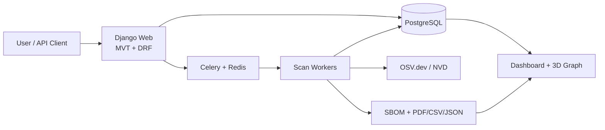
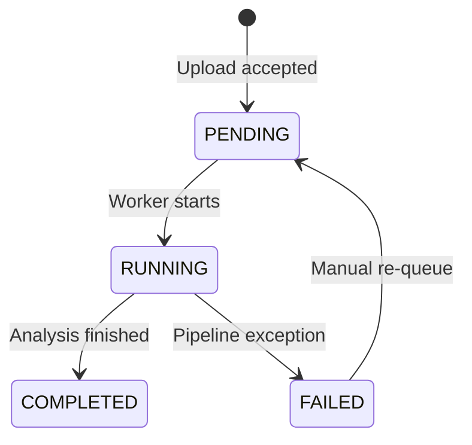

# Supply-ChainX

### AI-Powered Software Supply Chain Security Intelligence Platform

| Field | Detail |
|---|---|
| **Owner / Maintainer** | **Njbalamani** |
| **Repository** | [Njbalamani/Supply-ChainX](https://github.com/Njbalamani/Supply-ChainX) |
| **Primary branch** | `main` |
| **Application folder** | [`supply-chain/`](supply-chain/README.md) |
| **Repository snapshot** | 24/11/2024 |
| **Version** | 1.0.0 |
| **License** | MIT — Copyright (c) 2026 Njbalamani |
| **Status** | Complete Django application; checks clean; tests passing |

---

## 1. Overview

Supply-ChainX converts an untrusted source-code ZIP into a reproducible supply-chain security assessment. It reads dependency manifests, generates a CycloneDX 1.5 SBOM, queries real advisory sources, maps transitive relationships, calculates risk and exports audit-ready reports.

This repository is organized as a single application folder:

```text
Supply-ChainX/
├── README.md                 # Repository landing page (this file)
└── supply-chain/             # Complete application and full documentation
```

The detailed documentation — architecture, workflow, database design, environment variables, command reference, API surface, security model and deployment — lives in **[`supply-chain/README.md`](supply-chain/README.md)**.

---

## 2. What the platform does

| Stage | Input | Output |
|---|---|---|
| Ingest | Source ZIP upload | Validated archive with SHA-256 digest |
| Parse | `requirements*.txt`, `package.json`, lockfiles, `yarn.lock`, `pom.xml` | Normalized dependency inventory with purls |
| Enrich | Dependency name/version/ecosystem | OSV.dev findings and optional NVD CVE records |
| Analyze | Dependency set + advisories | NetworkX graph, metrics, risk signals, license classification |
| Generate | Scan facts | CycloneDX SBOM, PDF/CSV/JSON reports, grounded recommendations |
| Present | Persisted results | MVT dashboard, Chart.js charts, Three.js graph, DRF API |

---

## 3. Repository structure

```text
Supply-ChainX/
├── README.md                          # Repository landing page
└── supply-chain/
    ├── README.md                      # Full professional documentation
    ├── LICENSE                        # MIT, Njbalamani
    ├── manage.py
    ├── requirements.txt
    ├── .env.example
    ├── .gitignore
    ├── .dockerignore
    ├── Dockerfile
    ├── docker-compose.yml
    ├── config/                        # Settings, URLs, Celery, DRF, middleware
    ├── accounts/                      # Custom user and roles
    ├── organizations/                 # Tenants and membership
    ├── projects/                      # Projects, archives, scans
    ├── dependency_parser/             # Secure ZIP and manifest parsing
    ├── sbom_generator/                # CycloneDX 1.5 generation
    ├── cve_intelligence/              # OSV/NVD clients and normalization
    ├── vulnerability_scanner/         # Findings and scan orchestration
    ├── dependency_graph/              # NetworkX analysis and risk signals
    ├── license_compliance/            # SPDX classification
    ├── ai_recommendations/            # Rule engine and optional LLM summary
    ├── reports/                       # PDF, CSV, SBOM and JSON exports
    ├── dashboard/                     # MVT dashboard and chart data
    ├── docs/                          # API, architecture, ER and deployment docs
    ├── templates/                     # Server-rendered UI
    ├── static/                        # Custom CSS/JS and vendored libraries
    ├── media/                         # Uploaded archives and generated reports
    └── tests/                         # Unit and integration tests
```

---

## 4. Architecture at a glance



Detailed diagrams are in the application README and in `supply-chain/docs/ARCHITECTURE.md`.

---

## 5. Scan workflow



| Step | Action | Result |
|---:|---|---|
| 1 | Create organization and project | Tenant-scoped workspace |
| 2 | Upload `source.zip` | Validated archive + SHA-256 |
| 3 | Queue `run_scan` | `Scan(PENDING)` |
| 4 | Parse manifests | Dependency rows |
| 5 | Query advisory sources | Vulnerabilities + source status |
| 6 | Build graph and classify licenses | Metrics + risk signals |
| 7 | Generate SBOM and reports | Audit artifacts |
| 8 | Finalize | `Scan(COMPLETED)` |

Full workflow: **[`supply-chain/README.md#7-application-workflow`](supply-chain/README.md#7-application-workflow)**

---

## 6. Technology stack

| Layer | Technology |
|---|---|
| Backend | Python 3.12, Django 6.1, Django REST Framework 3.18 |
| Database | PostgreSQL 16; SQLite for local tests |
| Async | Celery 5, Redis 7 |
| Security intelligence | OSV.dev, NVD, CycloneDX 1.5, NetworkX |
| Reporting | ReportLab, CSV, JSON |
| Frontend | HTML5, custom CSS3, vanilla JavaScript, Three.js, Chart.js |
| Deployment | Docker, Docker Compose, Gunicorn, WhiteNoise |

No Bootstrap is used.

---

## 7. Quick start

### 7.1 Local development

```powershell
git clone https://github.com/Njbalamani/Supply-ChainX.git
cd Supply-ChainX\supply-chain

python -m venv .venv
.\.venv\Scripts\Activate.ps1
pip install -r requirements.txt

copy .env.example .env
python manage.py migrate
python manage.py createsuperuser
python manage.py runserver
```

Open `http://127.0.0.1:8000/`.

### 7.2 Full container stack

```powershell
cd Supply-ChainX\supply-chain
copy .env.example .env
docker compose up --build -d
docker compose exec web python manage.py createsuperuser
```

| Service | Role |
|---|---|
| `web` | Django + Gunicorn |
| `worker` | Celery scan worker |
| `db` | PostgreSQL 16 |
| `redis` | Celery broker/result backend |

---

## 8. Essential commands

| Command | Purpose |
|---|---|
| `python manage.py check` | Run Django system checks |
| `python manage.py check --deploy` | Production security checks |
| `python manage.py migrate` | Apply database migrations |
| `python manage.py createsuperuser` | Create admin account |
| `python manage.py collectstatic --noinput` | Collect static files |
| `python manage.py runserver` | Start development server |
| `python manage.py test tests -v 1` | Run test suite |
| `celery -A config worker -l info -Q celery,scans,maintenance` | Start scan worker |
| `docker compose up --build -d` | Start full stack |
| `docker compose logs -f worker` | Follow worker logs |

Complete command reference: **[`supply-chain/README.md#11-command-reference`](supply-chain/README.md#11-command-reference)**

---

## 9. Verification

```powershell
$env:DB_ENGINE='django.db.backends.sqlite3'
python manage.py check
python manage.py test tests -v 1
```

| Check | Result |
|---|---:|
| Django system checks | 0 issues |
| Tests discovered | 18 |
| Tests passed | 17 |
| Optional live OSV test | 1 skipped |
| Static collection | Successful |

---

## 10. Documentation index

| Document | Scope |
|---|---|
| [`supply-chain/README.md`](supply-chain/README.md) | Full platform documentation with diagrams, tables and commands |
| [`supply-chain/docs/API.md`](supply-chain/docs/API.md) | REST API endpoints and authentication |
| [`supply-chain/docs/ARCHITECTURE.md`](supply-chain/docs/ARCHITECTURE.md) | Architecture and scan pipeline |
| [`supply-chain/docs/ER_DIAGRAM.md`](supply-chain/docs/ER_DIAGRAM.md) | Database relationships and constraints |
| [`supply-chain/docs/DEPLOYMENT.md`](supply-chain/docs/DEPLOYMENT.md) | Production deployment guide |
| [`supply-chain/LICENSE`](supply-chain/LICENSE) | MIT license text |

---

## 11. Author and license

| | |
|---|---|
| **Author / Maintainer** | **Njbalamani** |
| **GitHub** | [Njbalamani/Supply-ChainX](https://github.com/Njbalamani/Supply-ChainX) |
| **License** | MIT |
| **Copyright** | Copyright (c) 2026 Njbalamani |

This project is provided under the MIT License. See [`supply-chain/LICENSE`](supply-chain/LICENSE) for the complete text.

---

**Supply-ChainX — verifiable software supply chain intelligence, built by Njbalamani.**
