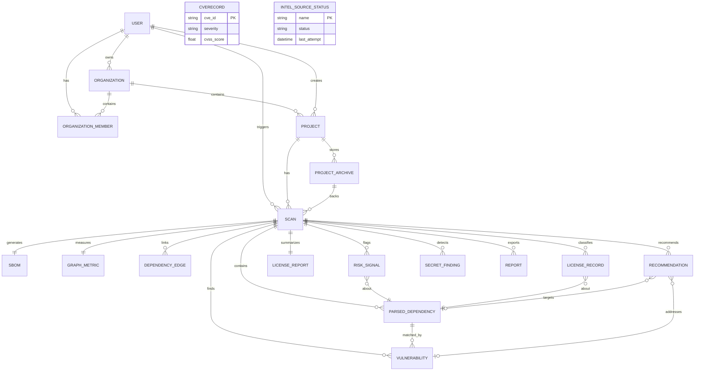

# Database ER Diagram

## Mermaid source



## Textual relationships

```text
Organization (1) ────< (N) OrganizationMember (N) >──── (1) User
Organization (1) ────< (N) Project
User (1) ───────────< (N) Project.created_by
User (1) ───────────< (N) Scan.triggered_by

Project (1) ────────< (N) ProjectArchive
Project (1) ────────< (N) Scan
Scan (1) ───────────< (N) ParsedDependency
Scan (1) ───────────< (N) Vulnerability ──(N:1)──> ParsedDependency
Scan (1) ──────────── (1) SBOM
Scan (1) ──────────── (1) GraphMetric
Scan (1) ───────────< (N) DependencyEdge
Scan (1) ───────────< (N) RiskSignal ──(N:1)──> ParsedDependency
Scan (1) ───────────< (N) LicenseRecord ──(N:1)──> ParsedDependency
Scan (1) ──────────── (1) LicenseReport
Scan (1) ───────────< (N) Recommendation
Scan (1) ───────────< (N) SecretFinding
Scan (1) ───────────< (N) Report

CVERecord (global advisory cache) · IntelSourceStatus (global source health)
```

## Key constraints and indexes

| Constraint / index | Purpose |
|---|---|
| `uniq_org_project_name(organization, name)` | Prevents duplicate project names per tenant. |
| `uniq_org_member(organization, user)` | One membership per user per organization. |
| `uniq_scan_vuln_dependency(scan, vuln_id, dependency, package_version)` | Prevents duplicate advisory findings. |
| `uniq_scan_license(scan, package_name, version)` | Prevents duplicate license records. |
| `uniq_scan_edge(scan, source, target, edge_type)` | Prevents duplicate graph edges. |
| `Scan(project, status)` index | Efficient scan-history filtering. |
| `ParsedDependency(scan, name)` index | Fast dependency lookups. |
| `Vulnerability(scan, severity)` index | Severity filtering for dashboards. |
| `sha256` indexes on archive/SBOM/report | Integrity lookups and de-duplication support. |
